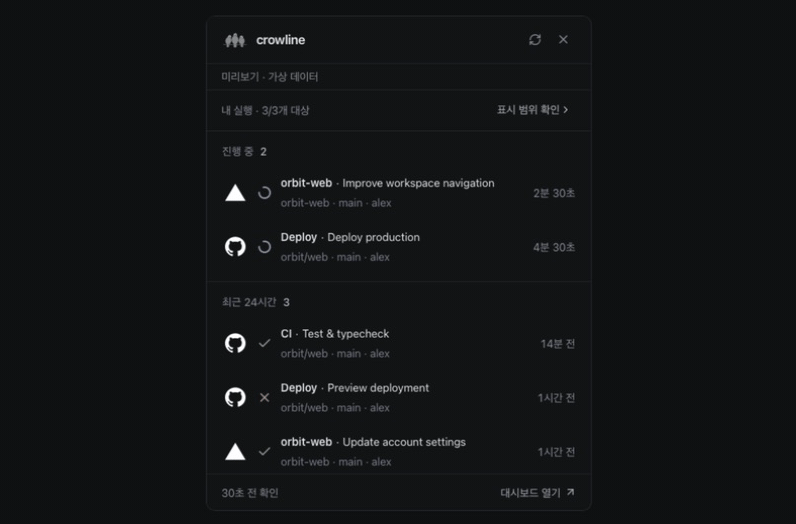
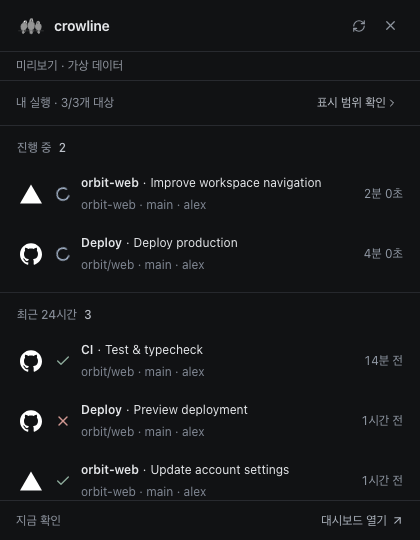
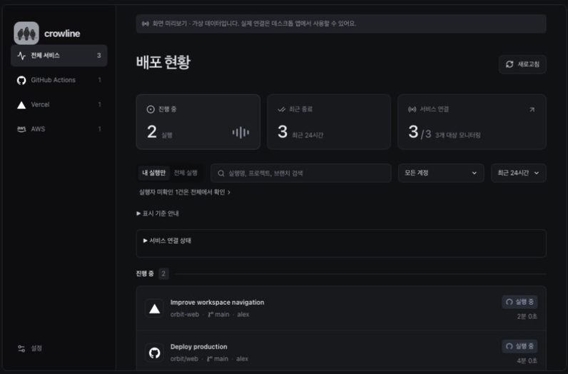
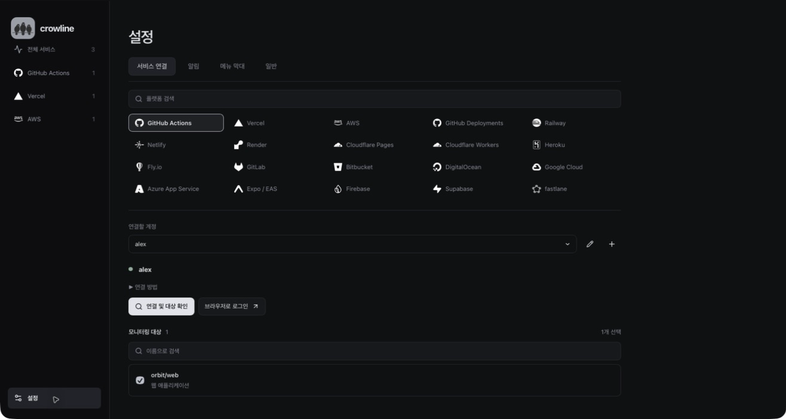
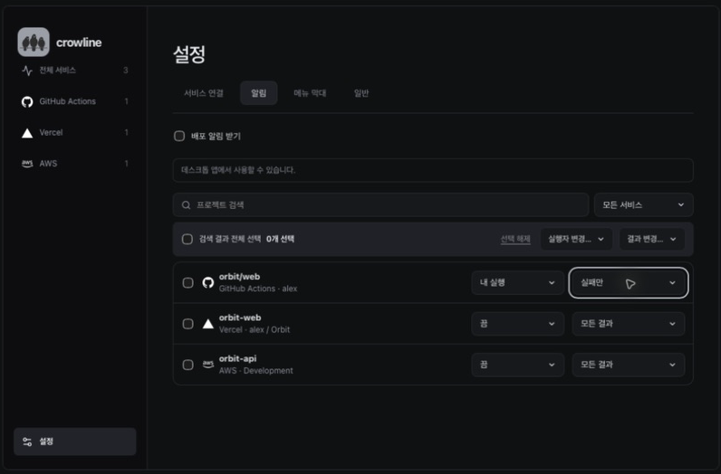

# crowline

[English](README.md) · [한국어](README.ko.md) · [日本語](README.ja.md) · 简体中文


crowline 是在菜单栏和系统托盘中查看部署与 CI 状态的应用。通过摘要面板快速查看最近的执行记录，在仪表板中连接账号、搜索历史并设置通知。应用使用 Tauri 2、React、TypeScript 和 Rust 构建，所有服务查询都在本机进行。界面默认跟随系统语言，支持简体中文、英语、韩语和日语。

## 界面预览

菜单栏面板 → 查看部署状态 → 按服务筛选 → 连接账号 → 设置项目通知。



使用虚构项目和账号，在应用的浏览器预览中录制，界面语言为韩语。演示不包含真实部署或通知推送。

<details>
<summary>查看更多截图</summary>

**菜单栏面板** — 快速查看运行状态、分支和触发人。



**仪表板** — 集中查看正在运行的任务和最近的结果。



**账号连接** — 选择服务和账号，设置需要监控的项目。



**通知** — 为每个项目选择关注谁的执行记录，以及接收哪些结果。



</details>

## 开发环境与运行

需要 Node.js 22.23.3 或更高版本、pnpm 10 与 Rust stable。构建隔离 GitHub helper 还需要 Go 1.26.8（打包应用用户不需要）。macOS 需 Xcode Command Line Tools，Windows 需 Microsoft C++ Build Tools、WebView2 等 [Tauri 前置条件](https://v2.tauri.app/start/prerequisites/)。

```sh
git clone https://github.com/likeratel/crowline.git
cd crowline
pnpm install --frozen-lockfile
pnpm tools:prepare
pnpm tauri dev
```

`tools:prepare` 下载固定版本的 GitHub CLI、Node.js 与 Vercel CLI，并从经校验和验证的上游源码构建隔离 helper。它需要联网和数百 MB 磁盘空间，不会全局安装工具。

## 构建

```sh
pnpm desktop:build
```

包生成在 `src-tauri/target/release/bundle/`。请在 macOS 构建 macOS 应用，在 Windows 构建 Windows 安装程序。仓库中的多平台 CI 配置仅是配置，不能证明远程构建或公开安装包已经存在。

## 连接账号和选择项目

打开 **设置 → 连接**，选择服务并连接账号，再选择要监控的项目。修改会立即生效，可通过账号选择框旁的铅笔按钮修改别名。 可一次性全选或取消选择当前搜索结果，不会改变被搜索条件隐藏的项目或其他账号的选择。

GitHub 和 Vercel 可复用本地 CLI 登录，也可通过浏览器添加其他账号。安装包已包含这两个服务的 CLI。AWS 使用现有配置文件和所选区域，启动 SSO 登录需要 AWS CLI。其他 CLI 集成需要自行安装官方 CLI 并登录。

删除额外的 CLI 账号只会移除监控配置，不会退出登录。删除 Bitbucket 连接时，也会删除应用保存的对应凭据。

## 已支持的监控

大多数服务使用官方 CLI 的登录信息；登录后重启 crowline 即可检测。Bitbucket Cloud 通过 API 令牌直接连接，无需部署 hook 或修改项目代码。

| 平台 | 监控 | 限制 |
| --- | --- | --- |
| GitHub Actions | 工作流运行 | 现有 `gh`；最近列表和活动状态分别查询 |
| Vercel | 项目部署 | 现有 `vercel`；排除 `BLOCKED` |
| AWS | CloudFormation、ECS、Amplify | 选定的配置文件和区域；执行者未知 |
| GitHub Deployments | 部署记录和最新状态 | 独立于 Actions；状态详情最多 20 条 |
| Railway、Netlify、Render | 部署历史 | 官方 CLI 和服务各自的最近列表限制 |
| Heroku、Fly.io | 应用发布 | Fly 展示发布状态，不代表机器运行状态 |
| GitLab.com | 部署与 CI 管道 | 不支持 self-managed 和执行者判定 |
| Bitbucket Cloud | 仓库 Pipelines | 邮箱和 API 令牌、最近记录与运行状态、执行者识别。不支持 Data Center |
| DigitalOcean、Google Cloud、Azure | 部署、Cloud Build/Run、Kudu | 各 CLI 的范围/输出/分页限制 |

EAS/Expo、fastlane、Cloudflare Pages/Workers、Firebase、Supabase 只提供目录中的限制说明，并非直接监控集成。现有 CLI/API 无法提供账户范围的目标发现或可信的部署历史。适用时请通过 GitHub Actions 或 GitLab 管道监控 CI 工作。参见[移动端服务商调研](docs/mobile-provider-notes.md)。新适配器仅以合成 fixture 与命令契约验证，不代表真实账号登录验证。

### Bitbucket Cloud

在 **设置 → 连接 → Bitbucket** 中输入 Atlassian 邮箱和 [API 令牌](https://support.atlassian.com/bitbucket-cloud/docs/create-an-api-token/)，再选择要监控的仓库。令牌需要 `read:user:bitbucket`、`read:workspace:bitbucket`、`read:repository:bitbucket` 和 `read:pipeline:bitbucket` 权限，无需安装 CLI。默认账号名称来自 Bitbucket，也可点击铅笔设置别名。通过 **更换令牌** 更新同一账号的凭据时，会保留已选仓库。

凭据仅保存在系统凭据存储中，不会写入设置文件、日志或安装包。删除 Bitbucket 连接时，也会删除对应凭据。菜单栏显示和项目通知沿用现有设置。无法确认执行者的 Pipeline 会标为未知，不计入“我的执行”。已于 2026-10-02 验证现有连接下 3 个仓库的最近执行及进行中状态查询。新账号连接流程仍未验证，自动测试使用虚构数据。

最近的 Pipeline 每页读取20条。运行、等待及暂停等状态并行查询，每种状态最多50条。仓库发现最多查询1,000个仓库、50页仓库列表和10页工作区列表；达到上限或部分查询失败时会在界面提示。

## 面板、通知和状态

- **菜单栏面板：** 显示服务图标、状态、分支和触发人。服务提供名称时，还会显示 GitHub 工作流、Vercel 部署、Bitbucket 自定义流水线、GitLab 流水线或任务、Cloud Build 触发器的名称。同名内容只显示一次。点击面板外或按 `Esc` 可关闭。
- **仪表板：** 按服务、账号、仅我的执行或全部执行筛选，并搜索历史。服务支持时可加载更早的记录。触发人未知的记录包含在全部执行中。显示筛选与通知规则相互独立。
- **通知：** 为每个项目选择关闭、仅我的执行或全部执行，以及所有结果、仅成功、仅失败或自定义。通知包含服务、结果、执行名称与标题、项目、分支和触发人。较长内容可能被系统横幅截断。启动后首次获取的历史结果不会触发通知。
- **菜单栏设置：** 选择显示的服务、项目以及每个区域的行数（1～10）。执行记录始终按最新时间排序。在 macOS 上可按住 Command 拖动乌鸦图标调整位置。
- **通用：** 管理语言、登录时启动、更新检查和应用版本。

超过 24 小时的进行中记录及 Vercel `BLOCKED` 记录会被隐藏。已完成的历史支持最近 24 小时或 7 天。crowline 只读，不会部署、重跑、取消任务或修改基础设施。

## 更新、数据和限制

存在运行中的任务时约每 30 秒查询一次，空闲时约每 120 秒一次，出错后会延长间隔。超时、部分查询失败和分页上限会在界面中显示。延迟获取的结果可能不触发通知，完整记录请查看服务本身。

设置保存在系统应用数据目录下的 `io.crowline.desktop/settings.json`。GitHub/Vercel 使用 CLI 凭据，AWS 使用配置文件。Bitbucket 凭据保存在系统凭据库中，安装包不包含用户账号信息。

当前版本尚未配置自动更新。仓库为私有仓库，其发布地址不能作为公开更新源。分发和更新配置请参阅[发布文档](docs/releases.md)。

本地已验证 macOS Apple Silicon 构建与启动、GitHub/Vercel 面板数据、Bitbucket 流水线查询，以及使用虚构数据的自动测试。Windows 运行、真实 AWS 连接、额外账号的浏览器登录及最新系统通知横幅仍未验证。依赖项问题记录在注明日期的[安全审查](docs/security-review.md)中。

其他资料见[文档索引](docs/README.md)。

## 开发检查

```sh
pnpm check
pnpm test
pnpm test:tools
pnpm exec playwright install chromium
pnpm test:e2e
pnpm build
cd src-tauri
cargo fmt --check
cargo test
cargo clippy --all-targets -- -D warnings
```

这些是当前检查命令，不声称固定测试数量或当前通过结果。

## 许可证

crowline 使用 [MIT License](LICENSE)。helper 工具版本和许可证见 [THIRD_PARTY_NOTICES.md](THIRD_PARTY_NOTICES.md)，打包声明位于 `tools/`。乌鸦图标来源见[品牌说明](docs/brand.md)。
